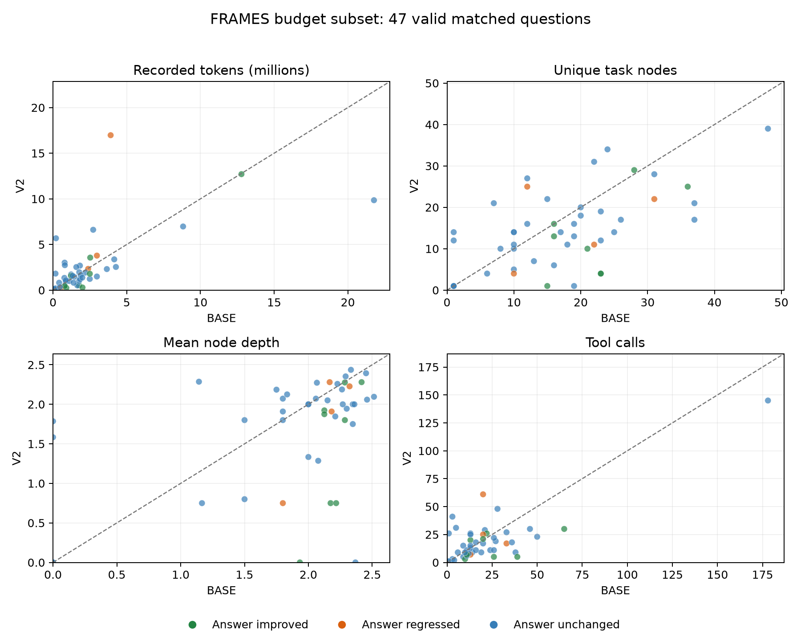

# FRAMES50 BASE / V2 完整报告

固定计划50题，有效答题配对 47 题。BASE正确率 72.340%，V2 80.851%；提升题号 [63, 112, 137, 304, 507, 527, 762, 765]，降低题号 [88, 494, 705, 737]。

运行后因预算收缩的子集；当前主结果只描述双方完成并成功原生评分的同题集合。失败、拒绝、缺失不填零；未按总体权重推断原783题。

| 一侧 | 完成/计划 | 完成率 | 执行状态 |
|---|---:|---:|---|
| BASE | 49/50 | 98.0% | {'COMPLETED': 49, 'SKIPPED_PROVIDER_BLOCKED': 1} |
| V2 | 47/50 | 94.0% | {'COMPLETED': 47, 'SKIPPED_PROVIDER_BLOCKED': 3} |

每点为同一题的BASE/V2资源或行为；虚线表示相同。颜色仅标记该题答案评分方向，不表示因果关系。

## 同题配对的每题行为与资源

所有行为指标先按整棵递归树汇总，再对题目等权；深度根节点为0。区间是配对题目bootstrap的条件区间，不能消除预算选择和缺失偏差。

| 指标 | n | BASE均值 | V2均值 | V2−BASE | 差值95%区间 | 增加/相同/减少 |
|---|---:|---:|---:|---:|---|---|
| 总token | 47 | 2,441,301.638 | 2,530,584.191 | 89,282.553 | -731,614.355, 948,739.996 | 22/0/25 |
| 输入token | 47 | 2,323,059.851 | 2,393,703.553 | 70,643.702 | -736,282.423, 905,335.740 | 21/0/26 |
| 输出token | 47 | 118,241.787 | 136,880.638 | 18,638.851 | -14,358.459, 52,642.281 | 26/0/21 |
| 缓存输入token | 47 | 416,321.362 | 468,224.000 | 51,902.638 | -303,212.732, 376,816.545 | 19/10/18 |
| LLM请求尝试数 | 47 | 60.426 | 53.766 | -6.660 | -16.021, 2.936 | 18/3/26 |
| 唯一逻辑节点 | 47 | 17.553 | 14.574 | -2.979 | -5.638, -0.383 | 14/6/27 |
| 展开节点 | 47 | 5.447 | 4.426 | -1.021 | -1.787, -0.277 | 11/9/27 |
| 叶节点 | 47 | 12.106 | 10.149 | -1.957 | -3.894, -0.085 | 15/5/27 |
| 最大深度 | 47 | 2.638 | 2.447 | -0.191 | -0.489, 0.106 | 3/36/8 |
| 节点加权平均深度 | 47 | 1.860 | 1.665 | -0.195 | -0.401, 0.005 | 14/6/27 |
| 到达深度3比例 | 47 | 0.851 | 0.766 | -0.085 | -0.213, 0.043 | 3/37/7 |
| 最大树宽 | 47 | 8.787 | 6.787 | -2.000 | -3.596, -0.489 | 12/11/24 |
| 展开节点平均分支数 | 47 | 2.699 | 2.759 | 0.061 | -0.252, 0.378 | 20/8/19 |
| 最大分支数 | 47 | 3.468 | 3.468 | 0.000 | -0.426, 0.426 | 12/24/11 |
| 工具调用 | 47 | 22.298 | 19.787 | -2.511 | -7.149, 2.106 | 16/5/26 |
| 搜索调用 | 47 | 21.064 | 18.319 | -2.745 | -7.298, 1.724 | 16/5/26 |
| 工具失败数 | 47 | 0.043 | 0.000 | -0.043 | -0.106, 0.000 | 0/45/2 |
| 每题耗时（秒） | 47 | 995.176 | 1,137.048 | 141.872 | -101.495, 393.672 | 27/0/20 |
| 原生记录重试数 | 47 | 0.000 | 0.000 | 0.000 | 0.000, 0.000 | 0/47/0 |

配对正确率差：8.51个百分点；95%条件区间 [-6.38, 23.40]。双方正确 30，双方错误 5。

## 分布与长尾

| 指标 | BASE中位数 | V2中位数 | BASE P90 | V2 P90 | BASE最大 | V2最大 |
|---|---:|---:|---:|---:|---:|---:|
| 总token | 1,653,000.000 | 1,569,483.000 | 4,008,058.800 | 6,056,666.600 | 21,770,458.000 | 16,971,733.000 |
| LLM请求尝试数 | 60.000 | 48.000 | 99.600 | 93.400 | 208.000 | 148.000 |
| 唯一逻辑节点 | 17.000 | 14.000 | 31.000 | 27.400 | 48.000 | 39.000 |
| 节点加权平均深度 | 2.125 | 1.944 | 2.363 | 2.280 | 2.514 | 2.436 |
| 工具调用 | 16.000 | 15.000 | 38.400 | 30.400 | 178.000 | 145.000 |
| 每题耗时（秒） | 755.803 | 888.648 | 2,043.658 | 2,557.257 | 3,930.753 | 4,031.203 |

BASE token最高5题（官方题号、token）：[(229, 21770458), (112, 12783896), (126, 8823460), (35, 4267375), (442, 4154052)]；占该侧主配对token总量 45.1%。

V2 token最高5题（官方题号、token）：[(737, 16971733), (112, 12706787), (229, 9850632), (126, 6971894), (33, 6614066)]；占该侧主配对token总量 44.7%。

## 全部50题两侧已记录的资源

包括拒绝/失败所花费的部分工作；输入token包含缓存token，不等同实际账单。未返回usage的请求不能当作零费用。评分器用量单独列出。

| 指标 | BASE累计 | V2累计 | 合计 |
|---|---:|---:|---:|
| 总token | 122,692,294.000 | 123,819,248.000 | 246,511,542.000 |
| 输入token | 116,525,401.000 | 117,306,920.000 | 233,832,321.000 |
| 输出token | 6,166,893.000 | 6,512,328.000 | 12,679,221.000 |
| LLM请求尝试数 | 3,050.000 | 2,590.000 | 5,640.000 |
| 工具调用 | 1,113.000 | 976.000 | 2,089.000 |

未记录usage的原生尝试数：BASE 0，V2 0。评分器history已记录usage：{'prompt_tokens': 33587, 'completion_tokens': 194704, 'total_tokens': 228291}。

## 工具使用

| 工具 | BASE每题调用 | V2每题调用 | BASE使用题率 | V2使用题率 | 题率差（pp） | BASE/V2使用后平均调用 |
|---|---:|---:|---:|---:|---:|---:|
| add | 0.106 | 0.064 | 2.1% | 4.3% | 2.128 | 5.000/1.500 |
| divide | 0.128 | 0.149 | 2.1% | 2.1% | 0.000 | 6.000/7.000 |
| list_files | 0.000 | 0.255 | 0.0% | 4.3% | 4.255 | 缺失/6.000 |
| multiply | 0.043 | 0.000 | 2.1% | 0.0% | -2.128 | 2.000/缺失 |
| read_file | 0.000 | 0.021 | 0.0% | 2.1% | 2.128 | 缺失/1.000 |
| read_file_content | 0.000 | 0.021 | 0.0% | 2.1% | 2.128 | 缺失/1.000 |
| register_artifact | 0.000 | 0.021 | 0.0% | 2.1% | 2.128 | 缺失/1.000 |
| run_python_code | 0.702 | 0.702 | 21.3% | 27.7% | 6.383 | 3.300/2.538 |
| save_file | 0.000 | 0.021 | 0.0% | 2.1% | 2.128 | 缺失/1.000 |
| search_files | 0.000 | 0.000 | 0.0% | 0.0% | 0.000 | 缺失/缺失 |
| subtract | 0.255 | 0.191 | 19.1% | 14.9% | -4.255 | 1.333/1.286 |
| web_search | 21.064 | 18.319 | 100.0% | 100.0% | 0.000 | 21.064/18.319 |
| write_file_content | 0.000 | 0.021 | 0.0% | 2.1% | 2.128 | 缺失/1.000 |

## 分层与BASE树深度的描述性对比

这些分组用于探索差异发生在哪里，样本小，不作为独立因果或显著性结论。

| 分组类型 | 分组 | n | BASE正确率 | V2正确率 | 提高题号 | 降低题号 | token均值差 | 节点均值差 | 工具均值差 |
|---|---|---:|---:|---:|---|---|---:|---:|---:|
| stratum | E2_L1 | 12 | 66.7% | 83.3% | [112, 507, 765] | [494] | 354,288.333 | 0.167 | 0.250 |
| stratum | E2_L2+ | 7 | 42.9% | 71.4% | [137, 527, 762] | [705] | -348,302.714 | -8.571 | -8.857 |
| stratum | E3_L1 | 7 | 100.0% | 100.0% | [] | [] | -470,977.429 | -6.571 | -8.286 |
| stratum | E3_L2+ | 8 | 62.5% | 62.5% | [304] | [737] | 1,999,289.375 | 4.125 | 7.500 |
| stratum | E4_L1 | 3 | 66.7% | 66.7% | [63] | [88] | -1,049,043.333 | -13.667 | -13.000 |
| stratum | E4_L2+ | 5 | 80.0% | 80.0% | [] | [] | -1,907,847.200 | -1.600 | -3.800 |
| stratum | E5+_L1 | 2 | 100.0% | 100.0% | [] | [] | 2,755,953.000 | 5.500 | 19.000 |
| stratum | E5+_L2+ | 3 | 100.0% | 100.0% | [] | [] | -1,046,691.333 | -10.333 | -13.667 |
| BASE_max_depth | 0 | 5 | 80.0% | 80.0% | [] | [] | 1,439,860.800 | 4.800 | 12.600 |
| BASE_max_depth | 2 | 2 | 100.0% | 100.0% | [] | [] | 1,044,626.500 | 6.000 | 12.000 |
| BASE_max_depth | 3 | 40 | 70.0% | 80.0% | [63, 112, 137, 304, 507, 527, 762, 765] | [88, 494, 705, 737] | -127,306.925 | -4.400 | -5.125 |

最大深度迁移（BASE→V2）：{'3->2': 1, '3->3': 33, '3->0': 2, '2->3': 1, '3->1': 4, '0->0': 3, '0->3': 2, '2->1': 1}。

完整数值与逐题数据见 report.json；所有极端题目保留。

逐题结果 (`archive://2026-10-02/frames/outputs/frames50_budget_BASE_V2_20261004T132044Z/analysis_report/per_question.md`; archival reference, not bundled) · 全部50题状态 (`archive://2026-10-02/frames/outputs/frames50_budget_BASE_V2_20261004T132044Z/aligned_results.md`; archival reference, not bundled) · 有效配对主结果 (`archive://2026-10-02/frames/outputs/frames50_budget_BASE_V2_20261004T132044Z/paired_results.md`; archival reference, not bundled)
